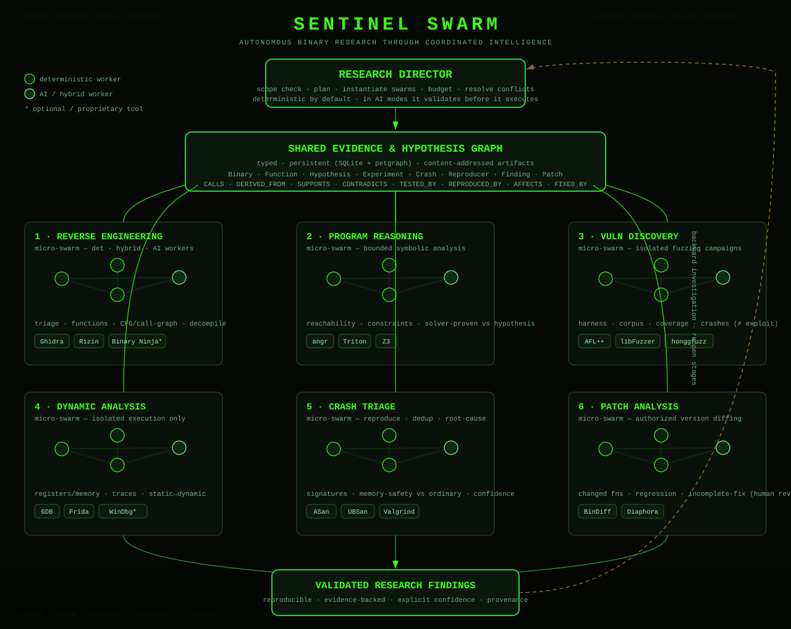
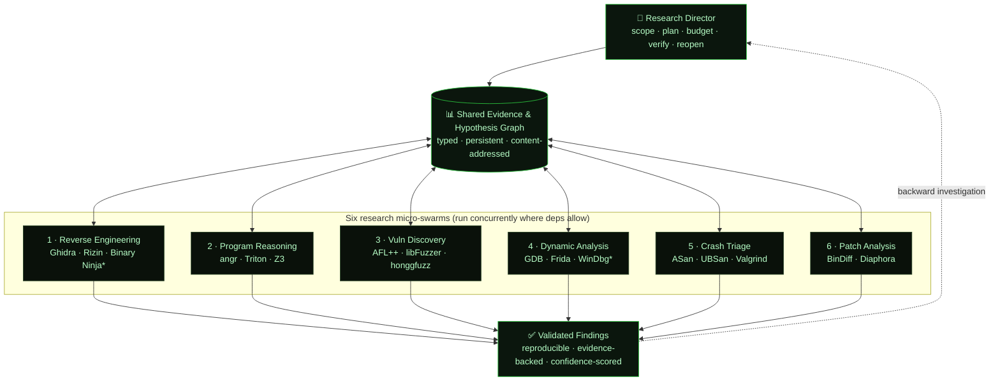

<div align="center">

# ◢◤ SENTINEL SWARM ◥◣

### Autonomous Binary Research Through Coordinated Intelligence

*A Rust-native, model-agnostic research platform that coordinates heterogeneous swarms of specialized agents to investigate compiled software — for **authorized** vulnerability research, reproducible security testing, and defensive analysis.*




</div>

> [!IMPORTANT]
> **Honesty first.** Sentinel Swarm is at an early stage. This repository currently contains the Rust workspace, the CLI skeleton, and the engineering plan. The architecture below describes the **target** system; throughout this README, advanced capabilities are described as **goals until implemented and benchmarked**. The [roadmap](ROADMAP.md) tracks what is real, what is experimental, and what is planned.

---

## What Sentinel Swarm does

Compiled software is still where the hardest, highest-stakes bugs live, and the tools that find them — disassemblers, symbolic executors, fuzzers, debuggers, sanitizers, binary-diffing engines — are powerful but fragmented, each speaking its own dialect and leaving a human to stitch the evidence together.

Sentinel Swarm's thesis is that this stitching is itself an orchestration problem. Instead of a single agent driving one tool, or six hardcoded steps running in sequence, it coordinates **heterogeneous micro-swarms** of specialized workers — some deterministic, some AI-driven — that share a single, typed **evidence and hypothesis graph**. Workers publish evidence; the graph is the source of truth; a central **Research Director** plans, budgets, verifies, and — crucially — can **reopen earlier stages** when a late finding changes the picture.

The result is meant to be **reproducible**: every observation carries its tool, version, configuration, binary hash, timestamp, confidence, and artifact references, so a finding can be traced all the way back to the bytes that produced it.

## Why it exists

- **Fragmentation.** No single tool answers "is this binary exploitable, and why?" — the answer lives across many tools and many runs.
- **Single agents stall.** One LLM driving one toolchain loses the thread on large binaries and can't explore competing explanations in parallel.
- **Uncoordinated agents duplicate and contradict.** Parallel agents without shared, typed evidence re-do work and disagree without resolution.
- **Reproducibility is the currency of research.** A finding you cannot reproduce — with provenance — is not a result. This is a research platform first; multiple studies are planned around it.

Sentinel Swarm's bet is that **evidence-driven coordination of heterogeneous swarms** beats both the single-agent and the uncoordinated-multi-agent baselines on time-to-finding, reproducibility, and false-positive rate — a claim to be *measured*, not asserted (see [Benchmarks](#benchmarks)).

---

## Architecture visualization

The [full architecture diagram](assets/architecture.svg) is above. A simplified Mermaid view:



`*` optional / proprietary tools — never required, always degrade gracefully.

## Terminal preview

Sentinel Swarm is a terminal tool. These are **mockups of the planned terminal UI** — illustrative, not recorded runs. No numbers or findings below are real; they exist to convey the intended feel.


<sub>**`sentinel doctor`** — environment health check and runtime tool detection; deterministic mode needs no AI provider. *(mockup)*</sub>


<sub>**`sentinel research ./target --mode hybrid`** — a live swarm dashboard: six micro-swarm stages with worker counts, the shared evidence graph, budget, and emerging findings. *(mockup)*</sub>


<sub>**`sentinel evidence <id>`** — one validated finding with its full evidence trail, provenance, and remediation note. Defensive, reproducible analysis only — no exploit or payload. *(mockup)*</sub>

## Micro-swarm execution model

> **Every research stage is a dynamically instantiated micro-swarm** — not a hardcoded step.

A micro-swarm is a group of workers that share an objective but may differ in tool, reasoning strategy, execution mode, and permissions. The runtime supports:

- **Heterogeneous workers** — deterministic, AI-driven, and hybrid side by side.
- **Dynamic spawning & termination**, parent→child subagents, **bounded** recursion and concurrency.
- **Capability-scoped tool access** — an agent can only use what it was granted, and **cannot grant itself more**.
- **Work deduplication** via stable binary/function identities, **structured handoffs** that reference immutable artifacts, and **independent verification** of results.
- **Resource budgets**, cancellation tokens, heartbeats, idempotent tasks, **checkpoint/resume**, and graceful shutdown.
- **Concurrency where dependencies permit**, and **backward investigation** — new findings can reopen earlier stages.

## Research stages and tool integrations

| # | Stage | Representative tools | What the swarm produces |
|---|---|---|---|
| 1 | **Reverse Engineering** | Ghidra, Rizin, Binary Ninja\* | format/arch, functions, call/control-flow graphs, decompilation, input-processing functions |
| 2 | **Program Reasoning** | angr, Triton, Z3 | reachability, bounded symbolic analysis, path constraints — **solver-proven vs. model-hypothesis** kept distinct |
| 3 | **Vulnerability Discovery** | AFL++, libFuzzer, honggfuzz | harnesses, corpora, isolated campaigns, coverage/crashes — **a crash is not proof of exploitability** |
| 4 | **Dynamic Analysis** | GDB, Frida, WinDbg\* | register/memory/stack state, runtime traces, static↔dynamic correlation (isolated execution only) |
| 5 | **Crash Triage** | ASan, UBSan, Valgrind | reproduction, signature dedup, root-cause, memory-safety vs. ordinary failures, confidence |
| 6 | **Patch Analysis** | BinDiff, Diaphora | changed functions, regression validation, candidate incomplete fixes **for human review** |

Tools are **optional and detected at runtime** (`sentinel doctor`). Deterministic mode requires none of the AI providers; proprietary tools (Binary Ninja, WinDbg, BinDiff) remain optional and must be licensed by you.

## Deterministic, hybrid, and autonomous modes

- **Deterministic** — research workflows run with **no LLM at all**. Fully reproducible; the baseline for every benchmark.
- **Hybrid** — deterministic workers execute the analysis; AI assists with interpretation and prioritization.
- **Autonomous** — AI agents plan and coordinate **bounded** investigations under enforced security policy. The model *proposes*; the controller *validates before execution*. **An LLM never runs unrestricted host commands.**

## Evidence and hypothesis graph

The graph — not agent chatter — is the source of truth. It is typed and persistent (SQLite + an in-memory graph, content-addressed artifact storage):

- **Nodes:** Binary, BinaryVersion, Function, BasicBlock, CallEdge, DataFlowObservation, ExecutionTrace, Hypothesis, Experiment, ToolInvocation, Crash, Reproducer, CandidateVulnerability, ValidatedFinding, Patch, RemediationRecommendation.
- **Edges:** `CALLS`, `DERIVED_FROM`, `SUPPORTS`, `CONTRADICTS`, `TESTED_BY`, `REPRODUCED_BY`, `AFFECTS`, `FIXED_BY`.
- **Every observation preserves:** tool id + version, model id (when applicable), binary hash, analysis configuration, timestamp, artifact references, confidence, and reproduction status.

**Model-generated conclusions are never represented as independently verified evidence.**

---

## Installation

> Requires a stable Rust toolchain. Analysis tools are optional and detected at runtime.

```bash
git clone https://github.com/Armur-Ai/sentinel-swarm
cd sentinel-swarm
cargo build --workspace
```

## Quickstart

```bash
# Initialize a local workspace (~/.sentinel)
cargo run -p sentinel-cli -- init

# See platform health and which optional tools are available
cargo run -p sentinel-cli -- doctor
```

Other commands (`inspect`, `research`, `jobs`, `findings`, `evidence`, `report`, `benchmark`) are defined in the CLI and land incrementally — the CLI **tells you honestly** when a command is not yet functional rather than pretending.

## Supported platforms

- **Primary:** Linux (x86-64). Deterministic mode is the first-class target.
- **macOS:** development and the deterministic core.
- **Windows:** a separate dynamic-analysis backend (WinDbg) is planned; Linux and Windows execution backends stay separate. WinDbg is never assumed present on Linux.

## Demonstration

Planned: a complete, reproducible walkthrough against a **deliberately vulnerable, authorized** test binary — from triage through a fuzzing campaign, sanitizer-backed crash triage, and a confidence-scored finding with its full evidence trail. This section will link a recorded run once Phase 1–3 land. (No fabricated output will appear here.)

---

## Security model

Sentinel Swarm is for **authorized** research only.

- **Explicit target authorization** and scope enforcement — scope is never silently expanded.
- **Isolated execution** of unknown native binaries in disposable environments (VM/microVM where feasible); **unknown binaries never run on the orchestration host**.
- **Immutable input snapshots**, restricted filesystem and network, CPU/memory/process/disk/time limits, credential isolation, and **auditable** execution.
- **Capability-based authorization** enforced by the runtime; **agents cannot modify their own security policies**.
- **Untrusted content handling** — decompiled strings, binary metadata, comments, and tool output are treated as **data, never as instructions**.

**Out of scope, by design:** unrestricted exploit deployment, stealth, persistence, credential theft, and unauthorized access. This platform exists to *understand and defend*, not to attack systems you don't own or aren't authorized to test.

## Roadmap

The public roadmap is in **[ROADMAP.md](ROADMAP.md)** (surface-level phases). In short: Phase 0 foundation → deterministic research → micro-swarm runtime → discovery & validation → program reasoning & patch analysis → AI intelligence → more tools/platforms → documentation & release.

## Benchmarks

Benchmarks are a first-class deliverable, not a footnote — and **no numbers are invented**. The planned comparison holds resource budgets equal across:

- **A.** A deterministic toolchain.
- **B.** A single AI agent with the same tools.
- **C.** Concurrent AI agents **without** structured evidence sharing.
- **D.** Sentinel Swarm — heterogeneous workers with evidence-driven coordination.

Measured on deliberately vulnerable and historical fixed/vulnerable open-source versions: time-to-first-validated-finding, unique reproducible defects, false-positive rate, human intervention, tool/AI cost, coordination overhead, evidence completeness, and reproducibility. Results will be published with their method when they exist.

## Inspiration and acknowledgments

Sentinel Swarm draws inspiration from pioneering autonomous security-research systems, while pursuing a **distinct Rust-native architecture** centered on heterogeneous concurrent micro-swarms, dynamic agent/subagent creation, deterministic *and* AI workers, persistent evidence-driven coordination, capability-scoped tools, and adaptive cross-stage investigations:

- **BEAR** — <https://github.com/LaureanoOlocco/bear>
- **Buttercup** — Trail of Bits' autonomous vulnerability-research system.
- **ATLANTIS** — Team Atlanta's autonomous cyber-reasoning system.

We make no claim of superiority over these systems without comparative evidence. We **welcome community contributions and research collaboration.**

## Contributing

Contributions and research collaboration are welcome — see **[CONTRIBUTING.md](CONTRIBUTING.md)** and the **[security policy](SECURITY.md)**. Two ground rules: build real, testable components (no mocks presented as integrations), and keep every artifact attributable.

## License

[MIT](LICENSE) © Armur AI.
